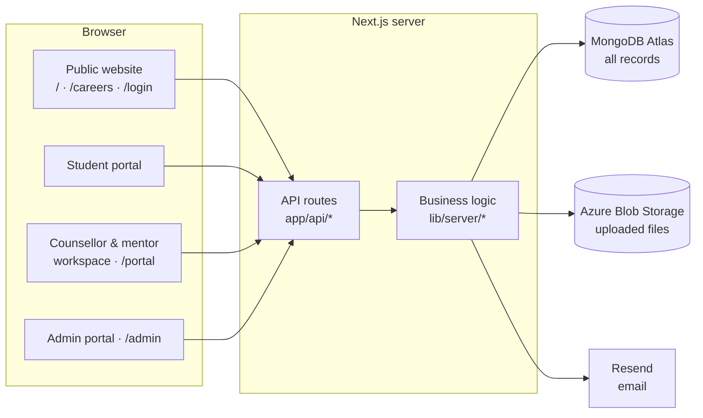

<div align="center">

<picture>
  <source media="(prefers-color-scheme: dark)" srcset="public/images/maxicareer-logo-white.png" />
  
</picture>

### Your career journey starts with the right guidance.

One platform for **students**, **counsellors**, **mentors** and the **Maxicareer team**:<br />
career roadmaps, 1-on-1 sessions, assignments, tests, payments and the public website, all in one place.

<br />


[Features](#-features) · [How it works](#-how-it-fits-together) · [Quick start](#-quick-start) · [Configuration](#%EF%B8%8F-configuration) · [Deployment](#-deployment)

</div>

---

## ✨ Features

<table>
<tr>
<td width="33%" valign="top">

### 🎓 Students
- Personal dashboard with an assigned **mentor** and **counsellor**
- Curriculum, tasks and file submissions
- Timed online tests and certificates
- Book **1-on-1 sessions** and join with one click
- Calendar, chat and events
- Profile, resume, invoices and renewals

</td>
<td width="33%" valign="top">

### 🧭 Counsellors & mentors
- Mentee list with progress and work
- Accept bookings and set **availability**
- Their own **meeting link** (Meet, Zoom, Teams)
- Session notes, follow-ups and grading
- Work hours, expense claims, payouts
- Reports on their students

</td>
<td width="33%" valign="top">

### 🛠️ Maxicareer team
- Students with **mentor and counsellor** assignment and filters
- Approvals, applications, roadmaps
- Assessments, curriculum, events
- Payments, payouts, expenditure
- Website CMS and careers page
- Staff roles, page access, audit log

</td>
</tr>
</table>

**Also included:** one sign-in page for every role · email-code sign-in for students · **forgot password** by email · private file storage · in-app notifications · CSV import and export · sample data you can load and clear.

| URL | For | What's there |
| --- | --- | --- |
| `/` | Everyone | Public website, and the student portal once signed in |
| `/login` · `/signup` | Everyone | One sign-in for all roles; each person lands on their own dashboard |
| `/portal` | Counsellors & mentors | Their workspace (sign-ups wait for admin approval) |
| `/admin` | Staff | Admin portal; pages shown depend on the staff role |
| `/careers` | Everyone | Job and internship openings published from the admin portal |

<details>
<summary><b>Student portal: all pages</b></summary>

| Group | Pages |
| --- | --- |
| Overview | **Dashboard** (mentor, counsellor, program, progress, book a meeting, personal plan) · **Notifications** |
| Learning | **Curriculum & syllabus** · **Tasks & assignments** (uploads, grades, feedback) · **Courses & tests** (timed, marked on the server) · **Resources** · **Milestones & certificates** |
| Guidance | **1-on-1 sessions** (Join button once the link is shared, history with notes) · **Calendar** · **Chat** · **Upcoming events** |
| Career & account | **Profile & resume** · **Add a service** · **Invoices** · **Renewal** |
| Help | **Support** · **Feedback** · **Tutorials** |

</details>

<details>
<summary><b>Counsellor & mentor workspace: all pages</b></summary>

Dashboard · Notifications · Calendar · My mentees · **1-on-1 sessions** (requests, upcoming, notes, add or change the meeting link) · **Appointment availability** (days, time slots, session length, days off, personal meeting link) · Pending tasks · Session notes · Projects & assignments · Follow-ups · Chat · Report analysis · Work hours · Payment history · Expenditure · Profile · Support

</details>

<details>
<summary><b>Admin portal: all pages</b></summary>

| Area | Pages |
| --- | --- |
| People | **Students** (assign mentor and counsellor inline; filter by cohort, status, mentor, counsellor, program and registration date) · Counsellors · Approvals · User management · Page access |
| Programs | Applications · Roadmaps · Programs & plans · Services · Curriculum & resources · Assessments · Events |
| Operations | **Sessions** (schedule, confirm student requests, paste meeting links) · Feedback · Form submissions · Reports |
| Finance | Payments (invoices, verification, payouts, renewals) · Expenditure |
| Website | Homepage · Navigation · Calls to action · Contact page · Career page · Footer · Social links · SEO · Article covers |
| System | Notifications · Audit log · Settings (database and storage health, sample data) |

</details>

---

## 🔗 How it fits together



Every dashboard reads and writes the same database through the API, so a change in one place shows up everywhere:

- **Booking:** a student books a counsellor → it appears in the counsellor's requests and the admin **Sessions** page → accepting it creates the session with the counsellor's **personal meeting link** and notifies the student. Links can also be pasted per session, and the student is notified each time.
- **Assignment:** an admin assigns a **mentor** and a **counsellor** → the student appears in both workspaces, and the student and the counsellor or mentor are each notified.
- **Learning:** submissions go to the task's author for review; grades and feedback come back as notifications. Test answer keys never leave the server.
- **Money:** buying a service or a renewal creates an **invoice**; marking it paid adds the service or extends the program. Counsellors log hours and claims; admins record **payouts**.
- **Approvals:** counsellor and mentor sign-ups wait in **Approvals**; approving one unlocks the login and lists them in the student directory.

---

## 🚀 Quick start

**You need:** Node.js 20 or newer, and a MongoDB database. A free [MongoDB Atlas](https://www.mongodb.com/atlas) cluster works. Azure Blob Storage and Resend are optional to start.

```bash
git clone https://github.com/manishrv1320/Maxicareer.git
cd Maxicareer
npm install
cp .env.example .env.local     # then fill in the values below
npm run dev
```

Open **http://localhost:3000/login** and sign in with the `ADMIN_EMAIL` and `ADMIN_PASSWORD` you set. That administrator is created automatically the first time the app connects to an empty database.

> [!TIP]
> Using MongoDB Atlas? Add your computer's IP address under **Security → Network Access** in Atlas. Otherwise the connection fails with a `tlsv1 alert internal error`.

---

## ⚙️ Configuration

All settings live in `.env.local` (never committed). [`.env.example`](.env.example) lists them with comments.

| Variable | Needed | What it does |
| --- | --- | --- |
| `MONGODB_URI` | **Yes** | MongoDB connection string (`mongodb+srv://…` from Atlas, or `mongodb://127.0.0.1:27017` locally) |
| `MONGODB_DB_NAME` | No | Database name. Default `maxicareer` |
| `ADMIN_EMAIL` · `ADMIN_PASSWORD` · `ADMIN_NAME` | First run | Creates the first administrator when the database has none |
| `AZURE_STORAGE_CONNECTION_STRING` | For uploads | Azure Storage account → *Access keys* → *Connection string* |
| `AZURE_STORAGE_CONTAINER` | No | Default `maxicareer-uploads`. Created automatically and kept **private** |
| `RESEND_API_KEY` | For email | [Resend](https://resend.com) key for sign-in codes, password resets and enquiry alerts. Without it, emails are only printed to the server console |
| `SUPPORT_MAIL_FROM` | No | Sender of password-reset emails. Default `Maxicareer Support <support@maxicareer.com>`. The domain must be verified in Resend |
| `MAIL_FROM` · `CONTACT_EMAIL` | No | Sender of other emails, and the inbox for contact-form enquiries |
| `APP_URL` | In production | Public address used in email links, e.g. `https://maxicareer.com` |
| `ENABLE_DEMO_LOGIN` | No | `false` turns off sample-account sign-in completely |

### Scripts

| Command | What it does |
| --- | --- |
| `npm run dev` | Development server on port 3000, reachable from your network |
| `npm run build` | Production build (Next.js standalone server, plus a static marketing bundle in `dist/`) |
| `npm start` | Runs the production build |
| `npm run lint` | Type-checks the whole project |

---

## 🗄️ Where data lives

| Platform | Stores |
| --- | --- |
| **MongoDB Atlas** | Every record: accounts (passwords are scrypt-hashed), students, counsellors, mentors, sessions, messages, notes, assignments, tests, invoices, payouts, notifications, website content, settings, and the index of uploaded files |
| **Azure Blob Storage** | The uploaded files, grouped by type and month: `avatar/`, `website/`, `attachment/`, `document/`, `resource/` → `2026/10/file-…-name.pdf` |
| **Resend** | Nothing stored; it only sends email |
| **The visitor's browser** | Only the sign-in cookie and small preferences such as the last open tab |

<details>
<summary><b>MongoDB collections</b></summary>

`users`, `auth_sessions`, `otp_codes`, `password_resets`, `students`, `counselors`, `mentors`, `counseling_requests`, `appointments`, `session_notes`, `recommendations`, `follow_up_tasks`, `messages`, `assessments`, `user_notifications`, `support_tickets`, `files`, `settings`, `form_submissions`, `admin_notifications`, `audit_logs`, `applications`, `roadmap_templates`, `student_roadmaps`, `approvals`, `mentoring_sessions`, `managed_users`, `services`, `broadcasts`, `assignments`, `calendar_notes`, `invoices`, `payouts`, `expenses`, `work_logs`, `feedback`, `events`, `tests`, `certificates`, `careers`, `curricula`, `resources`.

Indexes, including automatic expiry of sessions, codes and reset links, are created on first connection.

</details>

---

## 📁 Project structure

```text
Maxicareer/
├── app/                      Next.js App Router
│   ├── api/                  REST API: auth, platform actions, students, files, admin data…
│   ├── admin/ · portal/      Admin portal and counsellor/mentor workspace
│   ├── login/ · signup/      Shared sign-in, sign-up and password reset
│   └── careers/ · page.tsx   Public pages
├── lib/server/               Server logic: database, auth, storage, mail, platform rules
├── src/
│   ├── components/
│   │   ├── admin/            Admin portal pages and UI kit
│   │   ├── provider/         Counsellor & mentor workspace
│   │   ├── student/          Student portal pages
│   │   ├── workspace/        Shared sidebar shell, calendar and helpers
│   │   └── auth/             Sign-in, sign-up, forgot password
│   ├── services/ · hooks/    Client data store shared by the dashboards
│   └── types/ · data/        Shared types and default content
├── public/images/            Logos and illustrations
└── scripts/                  Dev and build runners
```

---

## 🔒 Security

- Passwords are hashed with **scrypt**. Sessions use an **httpOnly** cookie (secure in production) that lasts 14 days.
- Sign-in, codes, uploads and password resets are **rate-limited**, and accounts lock briefly after repeated wrong passwords.
- **Forgot password** sends a one-time link that expires after 30 minutes. Only its hash is stored, and using it signs the account out on every other device.
- Uploaded files stay in a **private** container. The app checks who is asking, then hands out a signed link that lasts 10 minutes.
- Meeting links must be real `https://` addresses. A counsellor's personal room link is never shown to other students.

> [!WARNING]
> **Sample data is for demos only.** Admins can load clearly marked sample records from **Settings → Sample data**. The sample accounts use publicly known passwords (`password123`, and `admin123` for the sample admin), and the sign-in page lists them while sample data is loaded. **Clear sample data and set `ENABLE_DEMO_LOGIN=false` before going live.**

---

## 🌐 Deployment

The app needs a Node.js server for its API, so deploy it as a full Next.js app, not a static export.

**Vercel:** import the repository, keep the *Next.js* preset, add the variables from `.env.example`, and deploy.
**Any Node host** (Azure App Service, a VPS…): run `npm ci && npm run build && npm start`. It listens on `PORT` (default 3000).

**Go-live checklist**

- [ ] `APP_URL` is set to your public address
- [ ] Your domain is verified in Resend and `RESEND_API_KEY` is set, so password resets and sign-in codes are emailed
- [ ] MongoDB Atlas **Network Access** allows your host. Most cloud hosts don't have fixed IPs, so this may mean `0.0.0.0/0` with a strong database password
- [ ] Sample data is cleared and `ENABLE_DEMO_LOGIN=false`
- [ ] The site is served over **HTTPS**

---

<div align="center">

**Maxicareer**: career guidance, mentorship and placement support.<br />
<sub>contact@maxicareer.com</sub>

</div>
